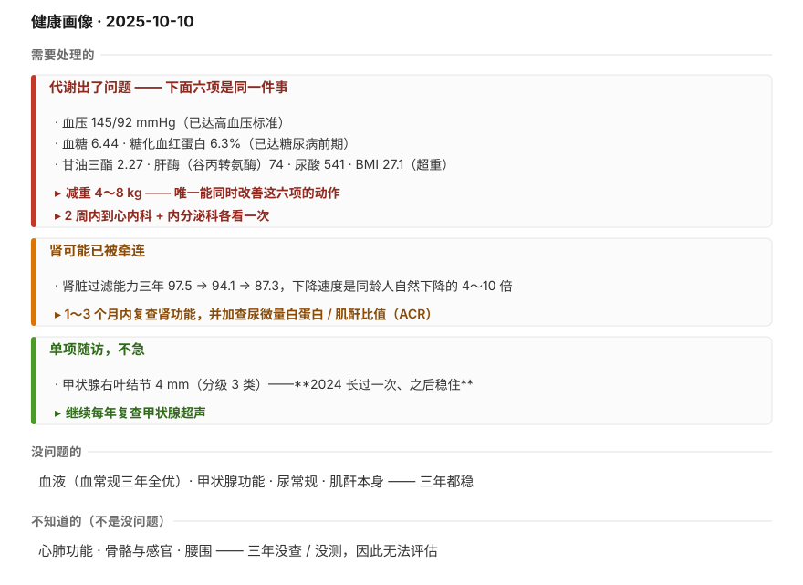
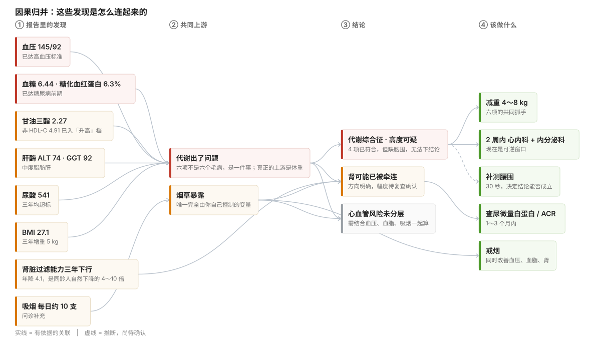

# 体检报告解读与健康管理建议

> **【样例说明】** 本文件是**报告样式的规格样例**，用 `research/testdata/` 的合成数据生成，**不是真实个人报告**。
>
> **结构版本 v6.3（2026-10-04）—— 两章 8 节 + 两个附录**
>
> ```
> 一、总体评估
>   1. 健康状况总览        （两张图：归类 + 关联）
>   2. 综合判断            （判断，不是摘要；第一句是好消息）
>   3. 正常与改善项
>   4. 问题分级总览        （级别 / 项目 / 现在的情况 / 这意味着什么）
>   5. 行动建议            （按「该怎么办」分五类，不只三件）
> 二、逐项分析            （按级别分节，节名与第 4 节的级别定义一致）
>   6. 需尽快就诊的项（🔴）
>   7. 需干预或定期复查的项（🟡）
>   8. 年度复查即可的项（🟢）
> 附录一：检查项目完整性评估   （对照卫健委指引的覆盖率与缺口 —— 属"评估"，不属"行动"）
> 附录二：数值对照表           （带医院用的对照表，含原报告页码）
> ```
>
> **为什么完整性评估在附录**：它是对**已完成的体检**做质量评估，不是要读者去做的**行动**；
> 放进「一、总体评估」会和第 5 节「行动建议」抢同一块位置。
>
> **标题命名规则**：① 不绑定单次体检（报告可能覆盖 1–5 年）；② 不用操作指引式的话（如"先看两张图"）；
> ③ 不用口语与内部代号（如"做得好""红黄绿"）；④ 同一层级的风格统一。
> 样例设定：男性，3 次体检，跨 2 家机构（2023 仁和 / 2024、2025 康泰）。

- 对象：受检者A
- 年龄 / 性别：43 岁 / 男
- 数据来源：仁和健康体检中心（2023-04-12）· 康泰综合医院（2024-09-21、2025-10-10）
- 覆盖时间：2023-04-12 ～ 2025-10-10（跨度 30 个月，3 次体检）
- 问诊补充：**吸烟（每日约 10 支）** · 无糖尿病 / 高血压诊断 · 未服降脂/降压药 · 家族史：父亲 62 岁脑梗死（**不构成指南定义的「早发」**——男性需 <55 岁）
- **本报告的结论建立在以下前提上**：43 岁 · 男性 · **未服用任何降脂/降压/降糖药物** · 无糖尿病与高血压诊断 · 吸烟（每日约 10 支）· 家族史「早发」不成立。
  其中任何一条不成立，**部分结论就要重算**（尤其是危险分层与"要不要吃药"两处）——请带着这一点看全文。

---

## 一、总体评估

### 1. 健康状况总览

> 这一节有两张图，**建议按顺序看**：第一张告诉你「问题分几类」，第二张告诉你「它们为什么是一件事」。

**图一：全部发现，归成三类**



*看什么*：**框在一起的项，是同一件事的不同表现**——这一点比单项数值更重要。

**图二：这些发现是怎么连起来的**



*看什么*：左边是发现，中间是共同上游，右边是结论和该做的事。**把这三行连着看，你就知道自己是怎么回事了：**

1. **血压、血糖、甘油三酯、肝酶、尿酸、BMI 六项 → 共同上游是「代谢出了问题」。** 它们不是六个独立毛病，是同一件事在六个地方的投影。所以"减重 4～8 kg"不是分别针对六项，而是**一次解决六项**。
2. **吸烟同时连着心血管和肾。** 它是整张图里**唯一完全由你控制、不需要任何检查和花费**的变量。
3. **「代谢综合征」这个结论目前还立不住**——不是证据不够，是**缺腰围这一个数据**（三套标准里：IDF 把腰围列为**必备条件**，2007 血脂指南版**必须有腰围才能判定**）。所以补测腰围是解锁结论的前置动作。

> ⚠️ 图里"代谢出了问题"是把多项发现**合并**起来看的判断，**不是诊断**；同框各项的依据见下文对应卡片。**「不知道的」一栏表示"没查"，不是"没问题"。**

### 2. 综合判断

血常规、甲状腺、尿常规这三年都很稳，肾的底子也还在——这些是真的没问题，你可以放心。

这份报告最想告诉你的是另一件事。**血压、血糖、血脂、肝酶、尿酸、体重，这六项三年里一起在往上走。** 它们不是六个毛病，是一个毛病——代谢出了状况，六个地方同时在提醒你。连肾也有一点被牵连：肾脏过滤能力这三年往下走了，速度比同龄人正常的下降快得多。

这话听着可能有点重，但请先别紧张。它要紧，是因为**这类问题不会自己好**；它还有救，是因为**现在回头完全来得及**——你的血压和血糖都只是刚刚越过线，还没到必须长期吃药的阶段。而且这六项有一个共同的抓手，就是**体重**：**减掉 4～8 公斤，六项会一起跟着松动**。如果你只打算做一件事，做这件。

建议两周内去心内科和内分泌科各看一次（与第 5 节 ① 的期限一致）——这两个科管的正好就是这条线，早去一次，能把很多事说清楚。眼下没有任何需要急诊的情况。

还有一件事你应该知道：**2024 年那份报告把血压 138/88 和糖化血红蛋白 5.9% 都写成了"正常"——按现在的标准，那时候就已经有信号了。** 所以这不是突然发生的，不用慌。但这两周，真的该动起来了。

### 3. 正常与改善项

**这些是你身体里好的部分，逐条列出来。**

- **血常规三年全优**：白细胞 6.2→6.8→7.1、血红蛋白 151→149→147、血小板 205→212→218，全部在理想区间中段，且三年几乎不动。这说明骨髓造血功能、免疫基础状态稳定，没有贫血、没有隐性感染或血液系统问题的迹象。
- **甲状腺功能三年稳定**：TSH 2.61→3.10、FT3 / FT4 均在正常中段。甲状腺是代谢的"总开关"，它没问题，意味着你的代谢问题**不是甲状腺引起的**，也就不需要往那个方向查。
- **甲状腺结节没再长**：2023 年 3 mm → 2024 年 4 mm → 2025 年仍是 4 mm（报告注明"与前次相仿"）。边界清晰、形态规则、分级 3 类。**2024 长过一次，之后稳住了。** 这类结节绝大多数是良性的，按年度复查即可，不必焦虑。
- **尿常规干净**：尿蛋白、尿糖均阴性。在血糖已经偏高的情况下这一点尤其有价值——说明肾脏的滤过屏障目前还没被高血糖损伤。
- **肌酐本身仍正常**：95.5 μmol/L 在参考范围内。肾脏过滤能力的下降值得盯，但**距离肾功能受损还有距离**，现在是可逆窗口。
- **一个容易被忽略的优点**：你三年做了 3 次体检，项目基本齐全，2024 起还加了糖化血红蛋白。**正因为有连续数据，才能看到这些轨道**——这比很多人做一次就丢开强得多。

### 4. 问题分级总览

> **这一节回答"我有哪些问题、各是什么状态"。该做什么在下一节。**
>
> 级别含义：🔴 **已达诊断或前期标准，需尽快就诊** ｜ 🟡 **需要干预或定期复查** ｜ 🟢 **正常或轻微** ｜ ⚪ **未评估**（是"不知道"，不是"没问题"）

| 级别 | 项目 | 现在的情况 | 这意味着什么 |
|---|---|---|---|
| 🔴 | **血压 145/92** | 三年 132/86 → 138/88 → 145/92，**逐年上升、今年越线** | 已达 1 级高血压。前两年机构都写"正常"，**其实轨道已经在往上走** |
| 🔴 | **血糖 6.44 + 糖化血红蛋白 6.3%** | 两项同时越线（上限 6.1 / 6.0），三年单调上升 | 已达糖尿病前期。**现在是可逆窗口**——再往上就是糖尿病，那就是终身管理 |
| 🟡 | **肝酶三项 + 中度脂肪肝** | 谷丙转氨酶 52→74、谷草转氨酶 34→42、谷氨酰转肽酶 68→92，**三年没有一次正常**；超声从轻度变中度 | **持续升高的肝酶 + 中度脂肪肝，需要排除肝纤维化**——这一点小套餐通常不做 |
| 🟡 | **血脂（四项偏高）** | 总胆固醇 5.84、甘油三酯 2.27、坏胆固醇 3.83 偏高，好胆固醇 0.93 偏低；非好胆固醇 4.91 进入"升高"档 | **三年没有一年正常**。坏胆固醇偏高 + 好胆固醇偏低同时存在，这种组合比单项异常更要紧 |
| 🟡 | **尿酸 541** | 三年都超标（上限 428） | 长期偏高会增加**痛风**和**肾结石**风险；但你还没发作过，现在管住还来得及 |
| 🟡 | **超重 BMI 27.1** | 三年 25.5 → 26.1 → 27.1，**体重增加 5 kg** | **它是上面六项的共同上游**——减重是唯一能同时改善全部六项的动作 |
| 🟡 | **肾脏过滤能力 87.3** | 三年 97.5 → 94.1 → 87.3，**年降约 4.1** | 下降速度是同龄人自然下降的 **4～10 倍**；还没到肾功能受损，**现在是可逆窗口** |
| 🟢 | 甲状腺结节 4 mm | 2023 年 3 mm → 2024 年 4 mm → 2025 年 4 mm；分级 3 类（低风险档） | 2024 长过一次、之后稳住；绝大多数是良性，按年复查即可 |
| ⚪ | **腰围** | **三年没测过** | IDF 要求它先达标、2007 血脂指南版必须有它才能判定——缺它，这个结论就下不了 |
| ⚪ | 外科 · 眼科 · 耳鼻咽喉科 · 口腔科 · 心电图 · 胸部影像 | **三年没查过 / 未见记录** | **"没查"不等于"没问题"**；见附录一（覆盖率 39%） |

> **级别含义再说一遍**：🔴 不是"危急值"，是"按指南已经到需要就诊的档位"；本报告没有危急值。

### 5. 行动建议

> 上一节讲"我有哪些问题"，**这一节讲"每件事该怎么办"**。
> 按**该怎么办**分成五类——**不是所有项都要行动**，先看它属于哪一类。

#### ① 需要去医院、有时间要求的

> **本类按「临床重要性」排，不是按时间排。这几件都要做，不必二选一。**

| 做什么 | 多久内 | 去哪 | 花费与时间 |
|---|---|---|---|
| **评估血压 + 血脂**（带 7 天家庭血压记录 + 三年体检报告 + 吸烟情况） | **2 周内** | 心内科 | 门诊约 20～50 元；半天内 |
| **评估血糖**，建议加做口服葡萄糖耐量试验 + 胰岛素释放（单看空腹血糖会漏掉餐后异常） | **2 周内** | 内分泌科 | 检查约 200～350 元；**建议请假半天**（空腹 8～12 小时） |
| **评估肝酶持续升高 + 中度脂肪肝**，需排除肝纤维化（肝脏弹性成像或血清学指标） | **1 个月内** | 消化内科 | 肝功能 50～100 元、弹性成像 300～500 元；**建议请假半天** |
| 复查**尿酸 + 肾功能**，并做肾脏超声查有无结石 | **1～3 个月内** | 全科 / 内分泌科 | 约 250～350 元；约 1 小时 |
| 复查**肾功能 + 尿微量白蛋白 / 肌酐比值（ACR）**——它比尿蛋白更早发现肾损伤 | **1～3 个月内** | 肾内科 / 全科 | 约 100～200 元；约 1 小时 |
| **复评减重效果**：复称体重、量腰围，同步复查血压 / 血糖 / 血脂 / 肝功能 | **3 个月后** | 全科 | 与复查合并抽血，约 150～250 元 |

#### ② 可以等下次体检一起做的（不急，但别漏）

| 做什么 | 为什么排在这里 |
|---|---|
| **加做甲状腺功能、糖化血红蛋白** | 甲状腺有结节却三年没查功能（详见附录一） |
| 每年：腹部超声、甲状腺超声 | 甲状腺结节、脂肪肝的年度随访 |

#### ③ 自己在家观察和记录的（不花钱，自己就能做）

| 观察什么 | 怎么做 | 出现什么情况要去医院 |
|---|---|---|
| **家庭血压** | 上臂式电子血压计（不要腕式，约 150～300 元）；坐位、背靠椅背、双脚着地、**先安静休息 5 分钟**；袖带与心脏同高；每天**早、晚各 1 次**，连测 **7 天** | **7 天平均 ≥135/85** → 心内科 |
| **体重** | 每周固定一天，晨起空腹称，记下来 | 连续两周不降反升 → 提前复诊 |
| **腰围** | 每月量一次：站直，肚脐上方一指，水平绕一圈，**呼气末**读数，软尺贴皮不勒紧 | 男性 **≥90 cm** → 就诊 |
| **血糖相关的信号** | 留意口渴、多尿、体重不明原因下降、伤口不易愈合 | 出现任一条 → 提前到内分泌科 |
| **身体发出的信号** | 见每张卡片末尾的「⚠️ 立即就医」 | 出现任何一条 → **立即急诊** |

> **记录格式**（家庭血压，7 天共 14 格）：
>
> | 天 | 早（收缩压/舒张压） | 晚（收缩压/舒张压） |
> |---|---|---|
> | 第 1 天 | 　/　 | 　/　 |
> | … | … | … |
> | 第 7 天 | 　/　 | 　/　 |

#### ④ 吃药和保健品：大部分不需要，一项要由医生定

- **药物**：
  - **血压**——已达 1 级高血压。按指南**先做生活方式干预（减重、限盐、运动）1～3 个月**；如果降不下来，再由心内科医生决定是否用药。
  - **血糖**——糖尿病前期的一线处理也是生活方式干预，多数情况先不用药；由内分泌科医生根据整体情况定。
  - **血脂**——按 21 格表：2025 那次 145/92 若确诊高血压，分层是**高危**；即使把它当作偶发、按"无高血压"算，也是**中危**。两个档位下坏胆固醇目标都是 **<2.6**，而你三年都在 3.6 以上——**是否用药必须由心内科医生决定**，不能按"低危人群参考水平"来判断。
  - **尿酸**——无症状高尿酸血症，一般先做生活方式干预，不用药。
- **保健品**：**不需要。** 常规吃保健品没有证据支持；如果是特定营养素缺乏，要先检查确认再补。
- ⚠️ **如果你已经在服用任何药物（降压、降糖、降脂等），本节不适用**——本报告是在「未服降脂药」的前提下写的。**切勿自行停药或改药**，一切由医生决定。
- ⛔ 本报告不给任何药名和剂量。如果需要用药，由医生开。

#### ⑤ 生活习惯要改的（自己就能做，回报最大）

| 改什么 | 具体怎么做 |
|---|---|
| **减重 4～8 kg** ← 回报最大 | 一条干预同时改善血压、血糖、血脂、肝酶、尿酸、脂肪肝六项。**具体**：主食换一半成杂粮；含糖饮料和酒先停 4 周；每周 150 分钟中等强度运动，分成 5 天；**每周固定一天早晨称重**并记下来。目标先设 4 kg，达成后再定下一步 |
| **戒烟** | 见下 |
| **限盐** | 每日 <5 g（约一啤酒瓶盖） |
| **酒精** | 现在每周约 2 次啤酒——**先停 4 周**，看甘油三酯和肝酶的变化 |
| **久坐** | 每 1 小时起身活动几分钟 |
| **睡眠** | 现在约 6 小时，争取 7～8 小时 |

**关于戒烟，具体怎么做：**

- **先算清量**：包年数 = 每天包数 × 吸烟年数。按每天 10 支（半包）算，若已吸烟 15 年就是约 7.5 包年——这个数决定你够不够格进肺癌筛查的高危人群。
- **方法比意志管用**：① 挑一个压力小的日子定成"戒烟日"；② 把烟、打火机、烟灰缸从家里和车里清出去；③ 找出你的"必抽时刻"（饭后、开车、应酬、加班），每个配一个替代动作（饭后立刻刷牙、开车嚼无糖口香糖、应酬时手边放茶杯）。
- **判断要不要找人帮忙**：**每天超过 10 支、或起床后 30 分钟内就要抽第一支**，说明已形成依赖，靠自己戒成功率低——**建议去戒烟门诊**——部分三甲医院设有，**去之前先打电话确认是否常态开诊**；由医生评估是否需要药物辅助。
- **允许反复**：复吸很常见，不是失败。多数人要在 3～5 次尝试后才真正戒断。

## 二、逐项分析

> **先回答一个疑问：为什么这份报告里有机构报告没标出来的问题？**
> 因为**单次体检报告只回答一个问题**——"那个数值超没超参考范围"。它不回答"**我是在往上走还是往下走**"，也不回答"**虽然还没超线，是不是已经进入指南说的过渡地带了**"。
> 参考范围是**人群**的范围；而每个人的身体有自己的**轨道**。一个指标可以三年都"正常"、但一直在爬——明年就越线。**这正是本报告存在的意义**（每个问题卡片的「趋势」栏都会指出这一点）。

> **读数前先知道这几件事**（影响"跨年对比"是否可靠）：
> - **2024 年换了机构**（仁和 → 康泰）：检测系统、参考范围、报告口径都变了，**跨 2024 年的比较要谨慎**，影像尺寸类尤其如此。
> - **血压的参考范围变了**（`<130/85` → `<140/90`）：同一读数在两套标准下判定不同。
> - **好胆固醇三年有两年完全相同**（0.98、0.98）：一位小数不差，这不寻常，**疑似未重新检测**——而它是"低好胆固醇"这一危险因素的唯一依据，建议向机构确认。

> 以下几节按级别展开，从最需要处理的开始。

> ⚠️ **通用急症信号**——出现以下任何一条，不要等体检，**立即急诊**：
> 胸痛 / 胸闷 / 呼吸困难 / 晕厥 · 突然偏瘫 / 言语不清 / 口角歪斜 · 呕血 / 黑便 / 便血 ·
> 持续剧烈腹痛伴发热呕吐 · 皮肤或眼白发黄、尿色深如浓茶 · 体重快速下降伴持续低热盗汗
>
> 各问题**自己特有的**急症信号，写在对应卡片的末尾（**⚠️ 立即就医**）。

> 排序原则：先可逆的，再不可逆的；先时间紧的，再可以等的。**同一件事只占一张卡片**（"脂肪肝 / 肝回声增强 / 肝酶升高"是一件事，写在肝脏那张里）。

---

### 6. 需尽快就诊的项（🔴）

#### 🔴【红色】血压已达高血压标准

- **结果**：145/92 mmHg。参考范围依机构而不同——2023 年仁和用的是 `<130/85`，2024 / 2025 年康泰用的是 `<140/90`。**按两家机构任何一套标准，2025 年这一次都超标。**
- **白话解释**：血压就是血液对血管壁的压力。145/92 意味着心脏每次泵血都要更用力，长期下去会磨损血管内壁，是脑卒中、心梗、肾损害最主要的可控危险因素。
- **可能原因与个人关联**：① 三年体重从 78 kg 涨到 83 kg，BMI 25.5→27.1，**减重不足是血压上行最常见的推手**；② 与本次同时出现的血脂异常、血糖偏高同属一个代谢背景，并非孤立问题；③ **家族史里父亲有高血压、并在 62 岁发生脑梗死**——一级亲属的血压与心脑血管病史，是你更该把血压管住的重要理由（注：62 岁不符合指南"早发家族史"的年龄定义，它影响的是"要不要更积极"的判断，而不是危险因素计数）。
- **趋势**：132/86 → 138/88 → 145/92，**三年单调上升，无一次回落**。
  **⚠️ 这里有机构漏掉的信号**：2024 那一次报告写的是"正常"（它的参考是 `<140/90`），但按《中国高血压防治指南（2024 年修订版）》，**138/88 落在"正常高值"的 130–139/85–89 段——指南把这一段列为"重点关注人群"**。也就是说，那次已经不是"没问题"了。
  血压不是化验项目，没有正常的起伏数据可算平时的正常起伏，因此只讲位置与方向。
- **最坏会怎样**：血压本身不会立刻怎样，但它是**脑卒中和心梗最主要的可控危险因素**。145/92 属 1 级高血压范围——**这个档位的意义不是「马上会出事」，而是「放着不管，十年后会明显增加风险」**。而且现在正是可逆窗口：**减重、限盐、运动的效果，通常相当于一种降压药**。
- **要吃药吗**：先别急着想药。**第一步是确诊**（单次诊室血压不够），确诊后医生会看整体风险再决定。你现在 BMI 27.1，靠减重限盐降下来的空间很大。**是否用药由心内科医生决定。**
- **严重度**：属 1 级高血压范围。**单次诊室血压不足以确诊**，但三次逐级上升的读数已经足够启动评估——不能等。
- **目标**：先确诊。若确诊，一般成人目标是 **<140/90**，能耐受者争取 **<130/80**。
- **现在做什么**：
  - **本周开始家庭血压监测**：每天早、晚各 1 次，坐位休息 5 分钟后测，连测 7 天，记录数值——**这是就诊时最有用的资料**，比诊室里一次读数可靠得多。
  - 限盐：每日食盐 **<5 g**（约一啤酒瓶盖）。
  - 减重：本次体重 83 kg，减 **5%～10%（约 4～8 kg）** 对血压的降压效果，通常相当于一种降压药的效力。
  - 每周 **150 分钟**中等强度有氧运动（快走、慢跑、游泳皆可，分散到 5 天）。
  - 戒烟限酒。**是否吸烟已按问诊流程补问：吸烟（每日约 10 支）**——这一条同时影响血脂的目标值与肾脏过滤能力的解读，已分别写入那两张卡片。
- **复查**｜⏱ **2 周内** · 🏥 心内科 · 💰 **血压计约 150～300 元（一次性）；门诊约 20～50 元** · 📋 带 7 天家庭血压记录 + 三年体检报告
- **如果暂时不复查**：至少把家庭血压记录下来。**若连续 3 天 ≥160/100 mmHg，不要再等。**
- **⚠️ 立即就医**：**剧烈头痛伴视物模糊** · **胸痛、呼吸困难** · **单侧肢体无力、言语不清、口角歪斜**（卒中征象，**立刻拨打急救电话，不要自行前往**）

---

---

#### 🔴【红色】血糖已达糖尿病前期，代谢综合征高度可疑

- **结果**：空腹血糖 6.44 mmol/L（参考 3.9～6.1），糖化血红蛋白 6.3%（参考 4.0～6.0）。两项同时越线。
- **白话解释**：血糖是血液里的糖。空腹 6.44 意味着在不吃东西的状态下血糖已经降不下来；糖化血红蛋白（糖化血红蛋白）反映过去 2～3 个月的平均血糖，6.3% 说明**不是某一天没睡好或吃太甜造成的，是持续的状态**。糖尿病前期是可逆的——现在干预效果最好，等到 ≥7.0 确诊糖尿病，就变成终身管理了。
- **可能原因与个人关联**：① BMI 27.1、三年增重 5 kg、中度脂肪肝——**内脏脂肪是胰岛素抵抗的主要来源**，这三件事和血糖升高是同一个原因的不同表现；② 母亲有 2 型糖尿病，**一级亲属史使你的基线风险本来就高于常人**；③ 本次报告注明"未检测胰岛素、C 肽"，因此**胰岛素抵抗的程度还没被量化**。
- **趋势**：5.8 → 6.00 → 6.44 mmol/L，**单调上升并越线**；糖化血红蛋白 5.9 → 6.3%，同样上行。
  **⚠️ 这里有机构漏掉的信号**：2024 那一次的糖化血红蛋白 5.9% 被报告标为"正常"（它的参考是 4.0～6.0），**但按 5.7%～6.4% 的糖尿病前期标准，它当时已属前期**。
  顺便说清一个**口径差异**（这不是国际差异，是国内指南版本之间的差异）：中国 2020 版糖尿病指南**没有**把糖化血红蛋白纳入前期诊断（只用空腹血糖和 OGTT）；2023 年《中国成人糖尿病前期干预的专家共识》首次提出具备条件者可用；**2024 版指南正式把 ≥5.7% 纳入**。另外中国人群研究提示 5.7% 这个切点在中国人里灵敏度偏低（有研究建议用更低的切点），国内糖化血红蛋白标准化检测的推广也仍在推进中。**所以 5.9% 算不算"前期"，取决于采用哪一版——但它显然不属于"可以不管"。**
- **最坏会怎样**：糖尿病前期不是糖尿病，**但每年约有 5%～10% 的人会进展成糖尿病**——一旦确诊就是终身管理。反过来看，**现在干预的效果也最好**：减重 5%～7% + 每周 150 分钟运动，能显著降低进展风险，相当一部分人能回到正常。
- **要吃药吗**：多数情况先不用。糖尿病前期的一线处理是生活方式干预；是否用药由内分泌科医生根据整体情况定。
- **严重度**：糖尿病前期。**尚未达到糖尿病诊断标准**，但按任何指南都已是需要正式干预的档位。
- **目标**：空腹血糖回到 **<6.1**，糖化血红蛋白回到 **<5.7%**。研究一致显示：减重 5%～7% + 每周 150 分钟运动，可显著降低进展为糖尿病的风险。
- **现在做什么**：
  - 主食换一半为全谷杂豆；**先减含糖饮料和精制点心**（这是见效最快的单项）。
  - 餐后散步 15～20 分钟——对餐后血糖的效果优于空腹运动。
  - 与血压那条**共用同一个减重目标**：减 4～8 kg，两个问题一起改善。
  - 记录 3 天饮食日记，就诊时带给医生。
- **复查**｜⏱ **2 周内** · 🏥 内分泌科 · 💰 **口服葡萄糖耐量试验 + 胰岛素释放约 200～350 元；半天，建议请假** · 📋 建议 **口服葡萄糖耐量试验（OGTT）+ 胰岛素释放试验**——单看空腹血糖会漏掉餐后血糖异常，而你这一档最容易在餐后先出问题
- **如果暂时不复查**：至少先做饮食与运动干预并记录体重。**若体重不降反升，不要推迟就诊。**
- **⚠️ 立即就医**：**明显口渴、多尿、体重不明原因下降、视物模糊、伤口不易愈合**

> **关于"代谢综合征"**：你有 4 项符合（甘油三酯高、好胆固醇低、血压高、血糖高），但三套权威标准里 **IDF 要求腰围先达标（男 ≥90 cm）、2007 血脂指南版必须有腰围才能判定**，而你三年都没测腰围，**因此无法下结论**。这不是措辞保守——是确实缺一个数据。**请本周自测腰围**（脐上 1 指水平、呼气末测量），补上后结论才成立。

---

### 7. 需干预或定期复查的项（🟡）

#### 🟡【黄色】肝酶持续升高 + 中度脂肪肝

- **结果**：谷丙转氨酶 52→61→74 U/L；谷草转氨酶 34→36→42 U/L；谷氨酰转肽酶 68→79→92 U/L。超声：2023 轻度脂肪肝 → 2025 中度脂肪肝。
- **白话解释**：谷丙转氨酶、谷草转氨酶是肝细胞里的酶，肝细胞受损时会释放到血里；谷氨酰转肽酶对酒精和脂肪代谢敏感。三项一起升高、且超声同时报脂肪肝，最常见的原因是**脂肪性肝病（代谢相关）**——也就是肝脏里的脂肪过多引起的炎症。谷丙转氨酶 74 约为上限的 **1.85 倍**，属于需要查清原因的程度。
  （参考：官方共识把谷丙转氨酶 ≥5 倍上限列为需要尽快检查、≥15 倍列为危急——你远没到那些门槛，所以**不是急症，但也不是可以放着不管的程度**。）
- **可能原因与个人关联**：与血糖、血脂、体重三条同源（胰岛素抵抗 → 肝脏脂肪堆积）。饮酒史已按问诊流程补问：**每周约 2 次、以啤酒为主**——谷氨酰转肽酶对酒精高度敏感，这部分的贡献不能排除，**戒酒 4 周后复查肝酶就能看出分晓**。
- **趋势**：谷丙转氨酶三年从 52 涨到 74，**没有一年回到正常**；超声从轻度进展到中度。
  另外：把 2023 与 2025 直接相比，**谷丙转氨酶累计上升 42.3%、谷氨酰转肽酶累计上升 35.3%**——这两项平时的正常起伏（按变异系数上/下界算）分别是 **27.1%～48.7%** 和 **20.3%～38.1%**：42.3% 与 35.3% 都**落在区间之内**，也就是说「幅度算不算超出噪声」**取决于采用哪一个变异系数取值**，尚无定论（方向本身的可靠性不受影响）。
- **最坏会怎样**：脂肪肝本身常见，**但「肝酶持续升高 + 中度脂肪肝」需要排除肝纤维化**——纤维化继续发展才是肝硬化。你 ALT 74（约 1.85 倍上限），离急症还远，但**不该放着不管**。好的一面是：这类脂肪肝在减重后大多能改善。
- **要吃药吗**：目前没有针对脂肪肝的特效药，**治疗的核心就是减重、限酒、控制血糖血脂**。是否用药由消化内科医生决定。
- **严重度**：黄色偏重。脂肪肝本身常见，但**"持续升高的肝酶 + 中度脂肪肝"需要排除肝纤维化**，这一点小体检套餐通常不做。
- **目标**：谷丙转氨酶回到 **<40 U/L**；超声脂肪肝程度减轻。
- **现在做什么**：减重（同前）；**严格限酒或戒酒 4 周后复查肝酶**——这是最便宜、信息量最大的一步；控制血糖血脂（这三件事同治）。
- **复查**｜⏱ **1 个月内** · 🏥 消化内科 · 💰 **肝功能约 50～100 元、肝脏弹性成像约 300～500 元；半天，建议请假** · 📋 肝功能 + **肝脏瞬时弹性成像（FibroScan）或肝纤维化血清学指标**（用于排除纤维化）
- **如果暂时不复查**：至少戒酒 4 周并在 1 个月后复查肝酶。**若肝酶继续上升，不要拖。**
- **⚠️ 立即就医**：**皮肤或眼白发黄 · 尿色加深如浓茶 · 右上腹持续疼痛 · 呕血、黑便**

---

---

#### 🟡【黄色】血脂异常（五项全部不在理想范围）

- **结果**（统一单位后）：总胆固醇 5.60→5.64→**5.84**；甘油三酯 1.90→1.99→**2.27**；坏胆固醇 3.62→3.65→**3.83**；好胆固醇 0.98→0.98→**0.93**；非好胆固醇 4.62→4.66→**4.91**。
- **白话解释**：坏胆固醇是"坏胆固醇"，负责把胆固醇往血管壁上送；好胆固醇是"好胆固醇"，负责往回清。你现在是**坏的偏高、好的偏低**，两个方向同时不利，这种组合对心血管风险的影响大于单项异常。甘油三酯高则往往与脂肪肝、血糖问题结伴出现。
- **按指南分档看**（《中国血脂管理指南（2023 年）》。注意：下面这张"参考水平"表**只适用于 ASCVD 低危人群**，而你不在低危——所以这些档位只用来描述"你的数偏离理想值多远"，**不能用来判断达没达标**；你的目标值由上面算出的分层决定）：

  | 项目 | 2025 值 | 指南分档 |
  |---|---|---|
  | 总胆固醇 | 5.84 | **边缘升高**（5.2～6.2） |
  | 坏胆固醇 | 3.83 | **边缘升高**（3.4～4.1） |
  | 甘油三酯 | 2.27 | **边缘升高**（1.7～2.3） |
  | 非好胆固醇 | 4.91 | **升高**（≥4.9） |
  | 好胆固醇 | 0.93 | **降低**（<1.0） |

  也就是说：**五项都在"边缘升高"或更差**——其中非好胆固醇已经越过"升高"的界，好胆固醇已属"降低"。
- **可能原因与个人关联**：同属代谢背景。**三条特别提醒**：① **你吸烟（每日约 10 支）**，吸烟会进一步降低好胆固醇并加速血管损伤，是本次心血管危险分层里最重的一个可改变因素；② **一级亲属里有明确的心脑血管病史**（父亲高血压、62 岁发生脑梗死）——按指南"早发家族史"的定义（男性<55 岁）**62 岁不满足**，所以它不进危险因素计数；但就诊时应当告诉医生，由医生判断要不要把目标定得更严；③ **好胆固醇三年两次一模一样（0.98、0.98）**，需确认机构是否真的重新检测了（见 §7 开头）——而它是当前"低好胆固醇"这一危险因素的唯一依据。
- **趋势**：五项三年全部朝不利方向或持平，**三年没有一年正常**。
- **最坏会怎样**：长期血脂异常会加速血管壁上的斑块形成，最终可能表现为心梗或脑卒中。**但程度要说清**：这些是长期累积的结果，不是"马上会出事"——现在是「长期管理」的档。**而你的分层并不算低**：中危～高危，加上吸烟，风险是叠在一起的。
- **要吃药吗**：**这一条要由心内科医生定**。按 21 格表：若 145/92 确诊高血压 → **高危**；按"无高血压"算 → **中危**。两档的目标值都是坏胆固醇 <2.6，而你三年都在 3.4 以上——**已经高于目标值**，不属于"不用管"的档。报告不给药名剂量，一切由医生决定。
- **严重度**：黄色。**危险分层已按 21 格表算出：中危～高危**（取决于 145/92 那次是否确诊为高血压；两个档位的坏胆固醇目标都是 <2.6）——就诊时请医生复核这个分层。
- **目标**：坏胆固醇 **<2.6 mmol/L**（这是中危～高危档的目标值；若确诊高血压等高危情形，医生可能定得更低）；甘油三酯 **<1.7**；好胆固醇越高越好。
- **现在做什么**：减少饱和脂肪（肥肉、动物油、油炸）与反式脂肪；增加深海鱼、坚果、蔬菜；**甘油三酯对酒精和含糖饮料特别敏感，先戒酒和甜饮 4 周看效果**；**戒烟**——这一条对好胆固醇与整体心血管风险的作用最大；运动提升好胆固醇的效果明确。
- **复查**｜⏱ **1 个月内** · 🏥 心内科 · 💰 **血脂全套约 80～150 元；空腹 10～12 小时；约 1 小时** · 📋 带三年血脂结果 + 血压记录 + 吸烟情况（医生需据此做整体风险评估后决定是否用药；**是否用药必须由医生决定**）
- **如果暂时不复查**：至少先做 4 周饮食干预并复查一次血脂，用以判断生活方式能改善多少。
- **⚠️ 立即就医**：**胸痛、胸闷、活动后气促 · 单侧肢体无力、言语不清**

---

---

#### 🟡【黄色】尿酸持续偏高

- **结果**：498 → 499.6 → **541.3 μmol/L**（参考上限 428）。三年均超标。
- **白话解释**：尿酸是嘌呤代谢的产物，长期偏高会增加痛风发作和肾结石风险，也与代谢综合征互为因果。
- **可能原因与个人关联**：与体重、脂肪肝、血糖同源。饮酒史已补问（**每周约 2 次、啤酒为主**）——**啤酒是尿酸的直接来源**，这一条与肝酶那张卡片共用同一个干预。
- **趋势**：三年均超标，2025 较 2024 上升约 8%。按正常的起伏计算，**这个升幅（8.3%）落在它平时的正常起伏区间之内（17.4%～28.4%）**——也就是说，**不能断言它这一年"真的涨了"，但可以确认它三年都稳定地偏高**。
- **最坏会怎样**：长期偏高会增加**痛风发作**和**肾结石**的风险。541 μmol/L 刚越过指南建议考虑用药的档位（≥540），但你还没有痛风发作。**多喝水、少啤酒、减重就能降下来**——你体重还有下降空间，这一项跟着改善的可能性很大。
- **要吃药吗**：现在不需要。无症状高尿酸血症一般先做生活方式干预；是否用药由医生判断。
- **严重度**：黄色。未出现痛风发作，属无症状高尿酸血症。
- **目标**：**<420 μmol/L**。
- **现在做什么**：每日饮水 **2000 mL 以上**；限制动物内脏、浓肉汤、海鲜、啤酒；减重本身即可降尿酸。
- **复查**｜⏱ **1～3 个月** · 🏥 全科 / 内分泌科 · 💰 **尿酸 + 肾功能约 80～150 元、肾超声约 150～200 元；约 1 小时** · 📋 尿酸 + 肾功能；建议同时做**肾脏超声**（查有无尿酸性结石）
- **如果暂时不复查**：至少先执行饮水与饮食干预。**若出现关节剧痛，不要自行用药。**
- **⚠️ 立即就医**：**单个关节（尤其大脚趾）突发红肿热痛**（痛风发作）· **腰部绞痛伴血尿**（泌尿系结石）

---

---

#### 🟡【黄色】超重，且三年持续增重

- **结果**：体重 78 → 80 → **83 kg**；BMI 25.5 → 26.1 → **27.1**。
- **白话解释**：BMI 是体重与身高的比。按中国标准，24～27.9 属超重。三年增重 5 kg，**BMI 三年的上升挡住了所有其他干预的效果**——血压、血糖、血脂、肝酶、尿酸这五条，每一条的主要干预都是同一件事。
- **可能原因与个人关联**：生活方式信息已按问诊流程补问：**久坐办公、每周运动不足 1 次、睡眠约 6 小时**。这三项都与体重增加和胰岛素抵抗直接相关，且都是可改的。
- **趋势**：单调上升，无回落。
- **最坏会怎样**：体重本身不是病，**它是上面六项的共同上游**——是它把血压、血糖、血脂、肝酶、尿酸一起往上推。反过来也成立：**减重是唯一能同时改善这六项的动作**。这就是它排在「行动建议」长期项最前面的原因。
- **要吃药吗**：不需要吃药。**减重本身就是治疗。**
- **严重度**：黄色。**但这是整套报告里"杠杆最大"的一条**——减重 5%～10% 可同时改善上面五个问题。
- **目标**：**减重 5%（约 4 kg）先行，争取 10%（约 8 kg）**；BMI 进入 <24。
- **现在做什么**：设定**每周 150 分钟**运动并写进日程；记录每日体重与腰围；把含糖饮料和酒精先停掉 4 周；**久坐每 1 小时起身活动**。
- **复查**｜⏱ **3 个月** · 🏥 全科 · 💰 **不额外花钱（体重秤 + 软尺约 50 元）** · 📋 复称体重、量腰围，并同步复查血压 / 血糖 / 血脂 / 肝功能，用数据判断干预是否有效
- **如果暂时不复查**：至少每周称一次体重并记录，这是最基础的自我监测。
- **⚠️ 立即就医**：若出现**体重在无干预下快速下降**，反而需要就诊排查。

---

---

#### 🟡【黄色】肾脏过滤能力逐年下降（肾功能需盯）

- **结果**：肌酐 88 → 90.2 → 95.5 μmol/L（三年均在参考范围内）；据国际通用公式估算的肾脏过滤能力 **97.5 → 94.1 → 87.3**，已进入轻度下降的档位（60～89）；尿蛋白阴性。
- **白话解释**：肾脏过滤能力是"肾脏每分钟能过滤多少血"的估算值，比单看肌酐更敏感，因为它同时计入了年龄。
- **趋势**——**这一条是"还没越线但需要盯"的代表**：
  - 肾脏过滤能力三年下行 97.5 → 94.1 → 87.3，**平均每年下降约 4.1 mL/min/1.73m²**。
  - **参照值**：健康成人（无高血压）随年龄的自然下降是 **每年 0.4～1.0**；合并肥胖约 0.85、糖尿病约 1.2。**你的下降速度是这个自然速率的 4～10 倍。**
  - 国际肾脏病指南（KDIGO）把"持续下降 >5/年"定义为"快速进展"——**你还没到那条线**，但已明显超出正常范围。**这不能用"年纪大了肾自然退化"来解释。**
  - 另一面：肌酐本身的升幅（+8.5%）**落在它平时的正常起伏区间之内（10.5%～15.9%）**，也就是说肌酐的上升在统计上还不能确认。肾脏过滤能力降幅看起来更大，是**公式对微弱变化的放大效应**。
  - 综合：**方向清楚、速度异常，但幅度本身的统计显著性有限**——所以处理是"复查确认"，不是"立即干预"。
- **可能原因与个人关联**：除代谢背景外，还有两条相关因素：**肌酐受肌肉量影响**，减重过程中肌肉量的变化也会影响它（本次未测胱抑素 C，无法剥离）；**你吸烟**，吸烟是独立于血压血糖的肾脏危险因素。
- **最坏会怎样**：它下降本身不可怕（87.3 只是轻度下降，离肾功能受损还有距离）。**真正的问题是它可能还没被查清**——如果尿里已经有微量蛋白而没查，就漏掉了早期肾损伤。这就是为什么要补查那一项。**现在还是可逆窗口。**
- **要吃药吗**：不需要。**保护肾脏最有效的两件事是控制血压和控制血糖**，都在前面的卡片里。
- **严重度**：黄色（需随访，非急症）。**它同时是代谢综合征可能已累及肾脏的早期信号。**
- **目标**：肾脏过滤能力稳定住，不再下行；肌酐回到接近基线。
- **现在做什么**：控制血压与血糖（**这两件是保护肾脏最有效的措施**）；**戒烟**；避免自行服用非甾体止痛药（如长期吃布洛芬类）；避免来路不明的中草药与保健品。
- **复查**｜⏱ **1～3 个月** · 🏥 肾内科 / 全科 · 💰 **肾功能 + 尿微量白蛋白约 100～200 元；约 1 小时** · 📋 肾功能（肌酐 + 肾脏过滤能力）+ **尿微量白蛋白 / 肌酐比值（ACR）**——ACR 是比尿蛋白更敏感的早期肾损伤指标，本次没做。**这一步很关键**：按 KDIGO，判断是否存在肾脏损伤要看肾脏过滤能力或肾损伤标志物，而 ACR 正好是后者；没查 ACR，就无法排除"肾已经有早期损伤"。
- **如果暂时不复查**：至少把血压血糖控制住。**若出现浮肿，不要等。**
- **⚠️ 立即就医**：**眼皮或下肢浮肿 · 尿量明显减少 · 尿泡久久不散**

---

### 8. 年度复查即可的项（🟢）

#### 🟢【绿色】甲状腺结节（随访即可）

- **结果**：甲状腺右叶结节 **3 mm（2023）→ 4 mm（2024）→ 4 mm（2025）**；边界清、形态规则，2025 报告注明"与前次相仿"。甲功三项正常。
- **白话解释**：甲状腺里的小疙瘩，绝大多数是良性的。甲状腺结节分级 3 类意味着恶性风险很低。
- **最坏会怎样**：**绝大多数是良性的**——你这个 4 mm、边界清、形态规则、属于低风险档，2024 长过一次之后已稳住。**最坏的情况概率很低**，按年复查就是为了万一。
- **要吃药吗**：不需要。甲功正常，说明它不影响功能。
- **判断为什么可以年度观察**：① 两年没有增大；② 边界清晰、形态规则，没有可疑特征；③ 甲功正常，说明它不影响功能。
- **复查**｜⏱ **每年 1 次** · 🏥 体检中心 / 内分泌科 · 💰 **甲状腺超声约 100～150 元；半天内** · 📋 甲状腺超声（不需要更频繁，也不需要现在处理）
- **⚠️ 提前就诊（不必等年度）**：**颈部肿块明显变大 · 声音嘶哑 · 吞咽不适**

> **说明**：以上为全部需要说明的问题。**血常规、甲状腺功能、尿常规已正常，不列入问题清单**；脂肪肝与肝酶升高是同一件事，合并在一张卡片内。

---

#### 有一类问题本次没有出现：还没越线、但一直在往不利方向走的项

> 除了已经超标的项目，还有一类值得单独盯：**三年都没越线、但一直在朝不利方向移动**——它会变成明年才被发现的问题。**这一类今年的"净增"是 0**：真正在动的项（肌酐、谷丙转氨酶、谷氨酰转肽酶、谷草转氨酶）已经并入上面那两张卡片；下面这几项虽然也在动，但按判据没有入选。

不过有几项你可能会想"它不是一直在涨吗"，这里说明为什么它们不算：

| 项目 | 三年 | 为什么不列入 |
|---|---|---|
| TSH（促甲状腺激素） | 2.61 → 2.88 → 3.10 | 方向一致，但**距上限 4.20 还有 26% 的空间** |
| 白细胞 | 6.2 → 6.8 → 7.1 | 涨了 14.5%，**但它平时的正常起伏区间是 24.0%～36.5%** |
| 血小板 | 205 → 212 → 218 | 涨了 6.3%，**平时的正常起伏区间是 20.1%～29.5%** |
| 血红蛋白 | 151 → 149 → 147 | 降了 2.6%，**平时的正常起伏区间是 9.6%～11.3%** |

> **为什么要这样分**：如果把"数字在动"都算成问题，几乎所有项目都会变成问题，反而看不出哪个真正要紧。**把真实变化和正常起伏分开，才能让该盯的项跳出来。**

---

---

## 附录一：检查项目完整性评估

> 这一节评估**体检项目查得全不全**——对照国家卫健委的项目指引，你查了多少、缺了什么。
> ⚠️ **本节只做评估，不给行动**：缺的项要不要补、什么时候补，写在**第 5 节的行动清单**里。

**对照依据**：国卫办医政函〔2025〕412 号《成人健康体检项目推荐指引（2025年版）》附件 2「基本体检项目」
**适用**：43 岁 / 男（该指引按年龄、性别定项目；你已满 40 岁，肺功能与骨密度进入推荐年龄）

#### 覆盖率：应查 23 项 —— 全覆盖 9 项、部分覆盖 2 项、缺 12 项（**39%**）

| 类别 | 应查 | 全覆盖 | 部分 | 缺 |
|---|---:|---:|---:|---:|
| 体格检查 | 6 | 0 | 1 | 5 |
| 实验室检查 | 11 | 8 | 1 | 2 |
| 辅助检查 | 6 | 1 | 0 | 5 |
| **合计** | **23** | **9** | **2** | **12** |

> **这个覆盖率偏低，值得认真看。** 缺的主要是**基础项里最便宜的那些**——不是做了贵的、省了便宜的，而是两头都没做。

#### 缺的这 12 项，各自能发现什么

**体格检查（5 项全缺）**

| 缺的项目 | 它本来能发现什么 |
|---|---|
| **内科**（肺、心脏、腹部） | 心肺听诊异常、腹部包块 |
| **外科**（皮肤、淋巴、头颈、甲状腺、脊柱、四肢、肛诊） | 淋巴结肿大、甲状腺/乳腺异常、直肠指检 |
| **眼科**（视力、眼压、眼底） | **眼底血管变化**——你已有血糖与血压问题，眼底是少数能直接看到血管的地方；还有青光眼、白内障 |
| **耳鼻咽喉科** | 听力下降、鼻腔与咽喉病变 |
| **口腔科** | 牙周病、龋齿、口腔黏膜病变 |

**实验室检查（缺 2 项）**

| 缺的项目 | 它本来能发现什么 |
|---|---|
| **粪便常规 + 隐血** | 消化道出血、结直肠癌的早期线索 |
| **血同型半胱氨酸** | 心血管风险的一个参考指标（你有多项代谢异常） |

**辅助检查（缺 5 项）**

| 缺的项目 | 它本来能发现什么 |
|---|---|
| **心电图（十二导联）** | 心律异常、心肌缺血、左心室肥厚——**你已有血压升高，需要一份心脏基线** |
| **胸部影像（正位片）** | 肺部与心脏的形态异常 |
| **人体成分分析** | 体脂率、肌肉与脂肪分布——**直接关系到减重减掉的是脂肪还是肌肉** |
| **肺功能** | 通气功能（慢阻肺、哮喘的早期线索）——你已满 40 岁进入推荐年龄 |
| **骨密度** | 骨量减少、骨质疏松——你已满 40 岁进入推荐年龄 |

> **"部分覆盖"的两项**：① 一般检查做了身高体重血压，但**腰围/臀围三年没测**；② 糖化血红蛋白 2024 年才开始做。

#### 超出指引要求、而且做得合适的

**腹部超声 · 甲状腺超声**

这两项不在「基本项目」里，但对你（有甲状腺结节、脂肪肝）是**恰当的加做**。

#### 另一个扣分项：检查项目三年没变过

2023、2024、2025 三年的检查项目**几乎完全一样**——**发现问题后没有扩展**。比如：
- 2024 年起血糖偏高、加了糖化血红蛋白 ✓（这一步做对了）
- 但**肝酶三年持续升高，却始终没加做肝纤维化评估**
- **尿酸三年超标，却始终没做肾脏超声**

> **怎么读这一节**：39% 的覆盖率不算合格。缺的 12 项里，**大部分是几十块钱的基础项**（心电图、粪便隐血、眼科、口腔科）。这不是"套餐不给"，是**这套套餐的配置本身偏薄**——建议下次挑套餐时拿这一节对照着看。

---

---

## 附录二：数值对照表

> **用途**：带去医院时对照用，也方便你自己回原报告核对。**最后一列是数值在原始报告里的页码。**
> ⚠️ 参考范围用的是**你最后一次体检机构标注的范围**；两家机构的范围可能不同。

| 项目 | 单位 | 参考范围 | 2023 | 2024 | 2025 | 原报告页 |
|---|---|---|---:|---:|---:|---|
| 血压 | mmHg | <140/90 | 132/86 | 138/88 | 145/92 | p2 / p1 / p1 |
| 体重 | kg | — | 78 | 80 | 83 | p1 / p1 / p1 |
| BMI |  | 18.5–23.9 | 25.5 | 26.1 | 27.1 | p1 / p1 / p1 |
| 谷丙转氨酶 | U/L | 0–40 | 52 | 61 | 74 | p1 / p1 / p1 |
| 谷草转氨酶 | U/L | 0–40 | 34 | 36 | 42 | p1 / p1 / p1 |
| 谷氨酰转肽酶 | U/L | 0–60 | 68 | 79 | 92 | p1 / p1 / p1 |
| 肌酐 | μmol/L | 57–111 | 88 | 90.2 ᵐ | 95.5 ᵐ | p1 / p1 / p1 |
| 尿酸 | μmol/L | 208–428 | 498 | 499.6 ᵐ | 541.3 ᵐ | p2 / p1 / p1 |
| 总胆固醇 | mmol/L | <5.2 | 5.60 | 5.64 ᵐ | 5.84 ᵐ | p1 / p1 / p1 |
| 甘油三酯 | mmol/L | <1.7 | 1.90 | 1.99 ᵐ | 2.27 ᵐ | p1 / p1 / p1 |
| 坏胆固醇 | mmol/L | <3.4 | 3.62 | 3.65 ᵐ | 3.83 ᵐ | p1 / p1 / p1 |
| 好胆固醇 | mmol/L | >1.04 | 0.98 | 0.98 ᵐ | 0.93 ᵐ | p1 / p1 / p1 |
| 空腹血糖 | mmol/L | 3.9–6.1 | 5.8 | 6.00 ᵐ | 6.44 ᵐ | p1 / p1 / p1 |
| 糖化血红蛋白 | % | 4.0–6.0 | — | 5.9 | 6.3 | — / p1 / p1 |

**读这张表要注意三件事**

1. **单位已经统一过了**：标 `ᵐ` 的格子，原始报告用的是 mg/dL，本表已换算成 mmol/L 或 μmol/L——**不换算直接比会得出完全错误的结论**（比如肌酐看起来"降了 98%"）。
2. **缺失就是缺失**：2023 年没做糖化血红蛋白，那格是空白，**不是"正常"**。
3. **参考范围两家机构不同**：血压在仁和是 `<130/85`、在康泰是 `<140/90`。**判断当时是否超标，要看当年报告自己写的范围**（见"原报告页"）。

> **数据年数说明**：本表按你实际有的 **3 次体检**展开。如果只有 1 次，就只有一列；如果有 5 次以上，中间年份会被省略（保留首次与最近三次），以免表格过宽。

## 免责声明

本解读用于健康教育和就医决策支持，**不能替代医生诊断**。若与医生面诊意见冲突，**以医生意见为准**。如有急症，请立即急诊。

本报告中的数值判定、单位换算与趋势计算均由脚本完成并可复算；原始报告请完整保存并携带就诊。

**本次数据情况**：数据来源为合成测试数据（本文档为报告样式样例）。真实使用时，本处将标注：本次可评估项目数 / 因数据缺口未能评估的项目数。

---

*报告生成时间：2026-10-04 · 结构版本 v6.3*
